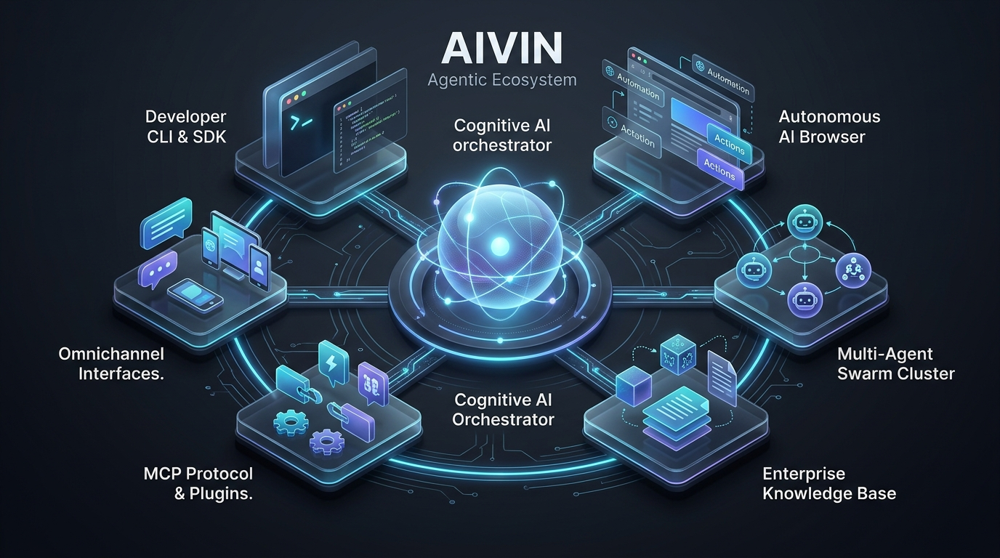
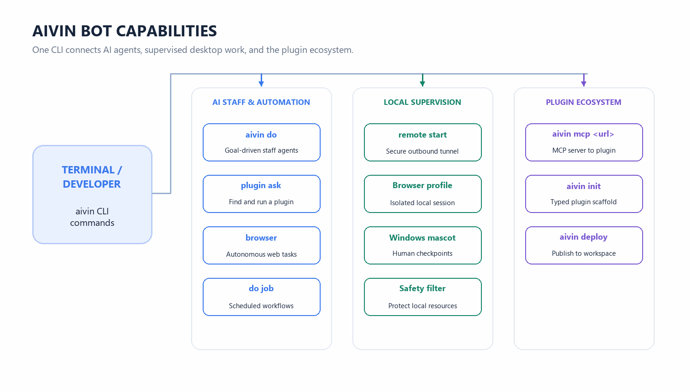
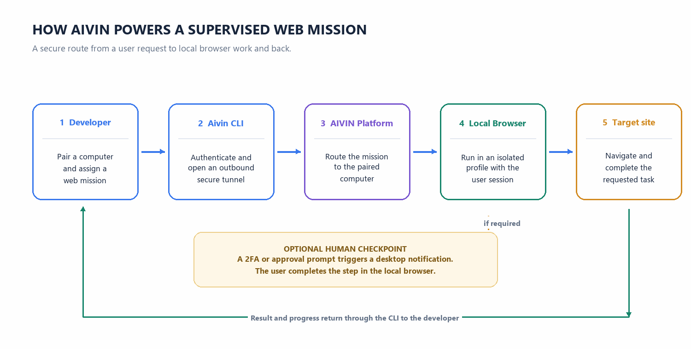
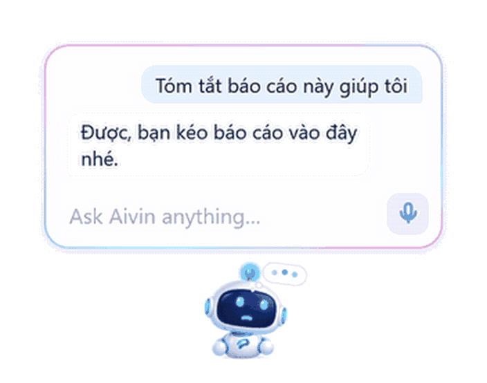
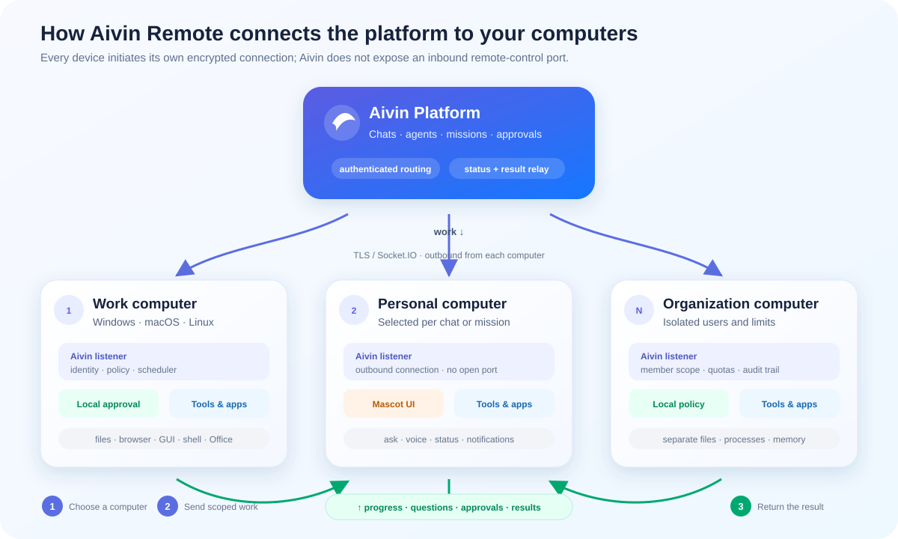

<div align="center">

# ⚡ @aivin-labs/cli

**The Command-Line Gateway to AIVIN Bot & The Agentic Ecosystem**

[](https://www.npmjs.com/package/@aivin-labs/cli)
[](https://nodejs.org/)
[](https://www.typescriptlang.org/)
[](https://modelcontextprotocol.io)
[](#install-without-nodejs-connect-a-computer-to-aivin)
[](https://opensource.org/licenses/MIT)

<p align="center">
  Building an autonomous AI agent that does real work usually requires weeks of plumbing before business logic: servers, model routing, queues, auth, and sandboxes. <b>Aivin collapses that into minutes.</b>
</p>

[The Aivin Ecosystem](#the-aivin-ecosystem) •
[AIVIN Bot in Action](#aivin-bot-capabilities-via-cli) •
[Architecture](#how-the-cli-powers-aivin-bot) •
[Installation](#install) •
[Quick Start](#quick-start) •
[Windows Mascot](#aivin-mascot-on-windows) •
[Command Reference](#command-overview)

---

</div>

## The Aivin Ecosystem

<p align="center">
  
</p>

`@aivin-labs/cli` is your day-to-day command center for interacting with **AIVIN Bot** and developing on the [Aivin Platform](https://aivin.cloud). Run `aivin init`, describe what you need in plain words, and get back a fully typed TypeScript project with a hot-reloading dev server, typed schemas, and single-command deployment to production.

Aivin is a modular, composable ecosystem for agentic software:

- **AIVIN Bot & AI Staff** — Persistent, goal-driven agents that reason over private data, use plugins as tools, and pause for human approval (HIL) mid-task.
- **Typed Plugins** — The core unit of work: a typed function (`main(mission, input, ctx)`) deployed in its own isolated container, searchable and callable by any agent across your organization.
- **Model Context Protocol (MCP)** — Wrap any [MCP](https://modelcontextprotocol.io) server's tools, resources, or prompts as first-class Aivin plugins with zero code (`aivin mcp <url>`).
- **Autonomous AI Browser** — A self-correcting agent driving a real browser (locally or server-side) with vision and DOM reasoning to accomplish tasks end-to-end (`aivin browser`).
- **Local Machine Supervised Execution** — Pair your local computer with AIVIN Bot (`aivin remote start`), allowing the bot to interact with logged-in web applications safely under explicit mission scopes.
- **Natural Language Automation** — Schedule recurring background tasks using plain English (`aivin do job "..."`) without ever touching cron syntax.
- **Plugin Marketplace** — Publish and share plugins or MCP proxies with team members or the public ecosystem (`aivin mcp <url> --publish`).

---

## AIVIN Bot Capabilities via CLI

The CLI brings the full power of **AIVIN Bot** directly into your terminal workflows:

<p align="center">
  
</p>

### 1. Goal-Driven Staff Agents (`aivin do`)
Dispatch an objective directly to an AI Staff agent. The agent breaks down the mission, queries relevant documents, invokes available plugins, and reports back:
```bash
aivin do researcher "Summarize key changes in our compliance policy and compare with last quarter"
```

### 2. Autonomous AI Browser (`aivin browser`)
Drive a dedicated browser session locally or server-side:
```bash
aivin browser "Open site X, navigate to billing, and download the latest tax statement"
```

### 3. Natural Language Scheduled Automation (`aivin do job`)
Define recurring background tasks in plain English:
```bash
aivin do job "Every Monday at 9:00 AM, query pending PRs and notify our team Slack channel"
```

### 4. Smart Plugin Matching (`aivin plugin ask`)
Pass an open-ended mission, and AIVIN Bot automatically searches your organization's catalog, selects the best-matching plugin, executes it with the required input, and prints the result:
```bash
aivin plugin ask "Convert the quarterly sales data in data.csv into an executive summary table"
```

---

## How the CLI Powers AIVIN Bot

<p align="center">
  
</p>

---

## Install

### Global Installation via npm

```bash
npm install -g @aivin-labs/cli
aivin --version
```

> **Requirement**: Node.js **≥ 22.0.0**. The CLI leverages Node's native TypeScript execution to run `src/main.ts` directly with zero compile steps.

---

### Install without Node.js (Connect a Computer to Aivin)

Self-contained standalone single-file binaries are available for every major operating system:

```powershell
# Windows 10/11 (PowerShell 5.1 or 7), x64 or ARM64
irm https://get.aivin.vn/install.ps1 | iex
```

```bash
# macOS (Intel / Apple Silicon) and Linux (x64 / arm64)
curl -fsSL https://get.aivin.vn/install.sh | sh
```

| Platform | Binary Build |
| :--- | :--- |
| **Windows x64 / ARM64** | `aivin-windows-x64.exe` / `aivin-windows-arm64.exe` |
| **macOS Intel / Apple Silicon** | `aivin-darwin-x64` / `aivin-darwin-arm64` |
| **Linux glibc x64 / arm64** | `aivin-linux-x64` / `aivin-linux-arm64` |
| **Linux musl (Alpine)** | `aivin-linux-x64-musl` / `aivin-linux-arm64-musl` |

On Windows, open Aivin from the system tray and choose **Sign in to connect** to link this computer through the usual browser login. You can also pair from Aivin Web with a one-time code (`aivin remote start --code <code>`).

---

## Quick Start

```bash
# 1. Scaffold a new plugin and generate working code from description
aivin init invoice-parser
cd invoice-parser && npm install

# 2. Run locally with hot-reloading (gRPC server + HTTP test shim on :4001)
aivin start

# 3. Log in to Aivin Platform
aivin login

# 4. Verify on non-production instance
aivin test

# 5. Ship to your organization
aivin deploy
```

Prefer a blank scaffold without AI-generated code? Use `aivin create my-plugin`.
Have an existing project you want to wrap? `aivin plugin convert` converts it in place.

---

## Aivin Mascot on Windows

<p align="center">
  
</p>

When Aivin Remote is running on Windows, an interactive animated **Aivin Mascot** floats smoothly above your desktop windows:

```bash
aivin remote start             # start remote listener and show mascot
aivin ui                       # open mascot ask box
aivin ui --demo                # preview all mascot animations
aivin remote mascot off        # disable mascot persistently
aivin remote mascot on         # re-enable mascot for next start
```

- **Visual State Indicators**: Displays real-time states (idle, working, thinking, waiting for approval, paused, offline, error).
- **Interactive Controls**: Click to open quick ask box, talk using live voice chat, or drag-and-drop local files directly onto the mascot to attach them to your next prompt.
- **Screen-Aware**: Automatically moves aside and hides itself during agent screenshot captures.

### How Remote Connects Aivin to Local Computers

<p align="center">
  
</p>

Each paired computer opens its own authenticated outbound connection to Aivin Platform. The platform routes a chat or mission to the selected computer; its listener applies local policy, requests approval for protected actions, runs the allowed local tools, and sends progress and results back. The mascot talks to the listener on the same computer—it is not a separate remote control channel.

---

## What You Get from a Scaffold

Every plugin scaffolded via `aivin init` or `aivin create` has a clear, standardized structure:

```text
my-plugin/
├── manifest.json      # Identity, I/O JSON Schema, triggers & AI descriptions
├── src/
│   ├── main.ts        # Typed entrypoint: main(mission, input, ctx)
│   └── service.ts     # Core business logic generated by AIVIN Bot
├── package.json       # Depends strictly on @aivin-labs/sdk
├── tsconfig.json      # Native TypeScript execution config
├── AGENTS.md          # Orientation guide for coding agents (Cursor, Claude Code)
├── test/              # Runnable integration tests with createMockSDK
└── .env               # Local development overrides
```

---

## Command Overview

| Command | Action |
| :--- | :--- |
| `aivin init [name]` | Scaffold a plugin **and** AI-generate working code from your description |
| `aivin create [name]` | Scaffold a clean, blank plugin project without AI code generation |
| `aivin validate` | Validate `manifest.json` schema without network calls |
| `aivin start` | Run plugin locally (gRPC server + `:4001` HTTP test shim) with hot reload |
| `aivin deploy` | Deploy the current plugin to your organization's workspace |
| `aivin test` | Deploy to a staging instance, run smoke tests, and print report |
| `aivin plugin search <query>` | Search your organization and public marketplace for reusable plugins |
| `aivin plugin ask [mission]` | Auto-select the best matching plugin and execute it against a mission |
| `aivin plugin trigger [mission] [input]` | Directly invoke a deployed plugin with payload and inspect output |
| `aivin plugin logs [pluginId]` | Stream live console output from a deployed plugin |
| `aivin connector` | Manage shared OAuth credentials and authentication namespaces |
| `aivin mcp <url>` | Scan any MCP server and instantly deploy all its tools as Aivin plugins |
| `aivin browser [mission]` | Launch an autonomous AI Browser mission driving a local or cloud browser |
| `aivin remote start` | Connect this computer to Aivin Platform with local CDP safety filters |
| `aivin ui` | Show the Windows desktop mascot or preview animations with `--demo` |
| `aivin do [agent] [mission]` | Dispatch a goal to an AI Staff agent to run in the background |
| `aivin do job [description]` | Create a recurring background automation job using plain English |
| `aivin task [description]` | Create, update, or track tasks within your active workspace |
| `aivin workspace` | Switch between organizations, workspaces, and projects |
| `aivin agent` | Search, install, create, or publish AI Staff agents |

---

## Relationship to @aivin-labs/sdk

- **`@aivin-labs/cli`** is developer tooling: It runs locally on your workstation or in CI environments. It is never bundled into your deployed container.
- **`@aivin-labs/sdk`** is the runtime library imported in code (`import { ai, vector, store } from '@aivin-labs/sdk'`). It provides the runtime server (`aivin-server`) executed inside deployed plugin containers.

---

## Environment Variables

| Variable | Target | Default |
| :--- | :--- | :--- |
| `SDK_ENDPOINT` | SDK gRPC connection | `sdk.aivin.cloud:443` |
| `AIVIN_BASE_URL` | API endpoints (`deploy`, `test`, `login`) | `https://api.aivin.cloud` |
| `AIVIN_WEB_URL` | Web dashboard & browser login | `https://brain.aivin.cloud` |
| `LOCAL_TEST_PORT` | Local test HTTP port (`aivin start`) | `4001` |
| `LOCAL_TEST_HOST` | Local test bind host | `127.0.0.1` |
| `AIVIN_SANDBOX_WORKER` | Isolated thread execution | `false` |

---

## Documentation

- [docs/AIVIN_MASCOT.md](docs/AIVIN_MASCOT.md) — The Windows desktop mascot: interactions, animations, shortcuts, privacy, and controls.
- [docs/GETTING_STARTED.md](docs/GETTING_STARTED.md) — Complete walkthrough: scaffold, develop, test, and deploy plugins and agents.
- [docs/CLI.md](docs/CLI.md) — Comprehensive command and flag reference manual.
- [docs/CHANGELOG.md](docs/CHANGELOG.md) — Version release history.
- [`@aivin-labs/sdk` Docs](https://github.com/aivin-labs/AIVIN-SDK/tree/main/docs) — Runtime SDK documentation (`ai`, `vector`, `store`).

---

## Development

```bash
npm install
npm run lint      # eslint .
npm run format    # prettier --write .
npm test          # node --test test/cli.validate.test.mjs
```

---

## License

MIT License. See [LICENSE](LICENSE) for details.

---

<div align="center">

Built for developers who want AI agents to do real, dependable work.

</div>
